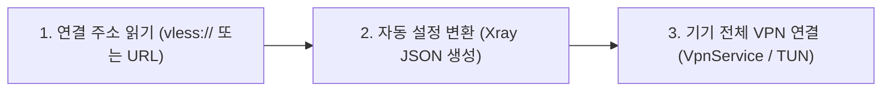

# Proxima for Android

안드로이드 스마트폰과 태블릿 환경에 최적화된 **VPN (가상 사설망) 연결 애플리케이션**입니다.

일반적인 프록시·VPN 클라이언트는 서버 주소, 포트, 암호화 방식, 전송 규칙 등 수많은 설정값을 사용자가 직접 입력하고 관리해야 하는 번거로움이 있습니다.  
**Proxima**는 이러한 복잡한 설정 과정을 내부 엔지니어링으로 자동화하여, **공유받은 한 줄의 연결 주소(링크)만 입력하면 즉시 최적의 경로로 안전하게 인터넷에 연결**할 수 있도록 설계되었습니다.

---

## 목차

- [작동 원리](#이-앱이-작동하는-원리)
- [주요 기능](#주요-기능)
- [사용 방법](#처음-쓰는-분들을-위한-사용-순서)
- [프로젝트 구조](#저장소-폴더-및-코드-구성)
- [개발자용 빌드 방법](#개발자용-빌드-방법)
- [라이선스](#라이선스)

---

## 이 앱이 작동하는 원리

Proxima는 네트워크 연결 요청부터 데이터 전송까지 **3단계 자동화 프로세스**로 동작합니다.



1. **연결 주소 읽기 및 검증**: 사용자가 입력한 `vless://` 단일 링크 또는 구독(Subscription) HTTPS URL을 해석하여 서버 위치, 전송 프로토콜 및 보안 설정값(`tls`, `reality`, `none`)을 안전하게 읽어 들입니다.
2. **자동 설정 변환 (Xray Core)**: 파싱된 정보를 바탕으로 네트워크 엔진인 **Xray-core**가 구동될 수 있는 최적의 상세 설정 구조체(JSON)를 앱 내부에서 자동으로 생성합니다.
3. **기기 전체 인터넷 연결 (Android VpnService)**: 안드로이드 OS의 `VpnService`를 구동하여 가상 터널(TUN 인터페이스)을 생성하고, 기기에서 발생하는 모든 네트워크 트래픽을 선별된 프록시 서버로 안전하게 터널링합니다.

---

## 주요 기능

### 1. 서버 등록 및 구독 관리

* **한 줄 연결 주소 (`vless://`) 지원**: 공유 링크 복사 및 붙여넣기만으로 간편히 등록합니다. 사전 주소 유효성 검사를 통해 필수 보안 파라미터 미비나 잘못된 형식을 차단합니다.
* **구독 주소 (HTTPS URL) 가져오기**: 여러 서버가 다중 포함된 멀티 노드 구독 링크를 단번에 동기화합니다.
  * **구독 프로필 정보 표시**: `subscription-userinfo` 헤더를 자동 파싱하여 **요금제 명칭, 총 제공량, 사용량, 남은 데이터, 만료 일자**를 메인 화면 상단에 직관적으로 시각화합니다.
* **파일 가져오기 / 내보내기**: 여러 연결 정보가 담긴 텍스트 파일을 앱으로 간편히 읽어오거나, 등록된 노드 목록을 백업 파일로 내보낼 수 있습니다.

### 2. 세 가지 연결 모드

상황 및 트래픽 성격에 따라 최적의 네트워크 통로를 선택할 수 있습니다.

| 연결 모드 | 동작 방식 | 추천 사용 상황 |
| :--- | :--- | :--- |
| **규칙 모드 (Rule)** | 접속 대상에 따라 우회 및 직결 자동 분기 | 일반적인 일상 사용 (속도 저하 및 해외 우회 차단 최소화) |
| **전역 모드 (Global)** | 모든 기기 트래픽을 선택한 VPN 서버로 강제 전송 | 공공 Wi-Fi 보안 강화, IP 접속 국가 전체 변경 필요 시 |
| **직결 모드 (Direct)** | VPN 연결 유지 상태에서 프록시 우회 (다이렉트 연결) | VPN 활성화 상태를 유지하면서 로컬 네트워크 통신 시 |

### 3. 서버 변경 및 빠른 실행 (QST)

* **연결 중 서버 무중단 변경**: VPN 연결을 재시작하지 않고도 노드를 즉시 변경할 수 있습니다. 백그라운드에서 네트워크 엔진만 정교하게 재로드되어 끊김 없이 연결을 유지합니다.
* **상단바 빠른 설정 타일 (Quick Settings Tile)**: 안드로이드 Quick Settings 창에 Proxima 타일을 추가하여, 앱을 열지 않고도 **한 번의 터치로 최근 사용한 서버에 즉시 연결/해제**할 수 있습니다.

### 4. 실시간 속도 확인 및 네트워크 진단

* **실시간 텔레메트리**: 초당 다운로드/업로드 속도 및 누적 트래픽 사용량을 실시간으로 갱신합니다.
* **네트워크 진단 도구**:
  * **외부 IP & 위치 조회**: 현재 노출되는 인터넷 IP 주소 및 국가/위치를 점검하여 VPN 정상 가동 여부를 검증합니다.
  * **DNS lookup 도구**: 도메인 주소(예: `example.com`)가 IP로 정상 변환되는지 판별하여 네트워크/서버 장애 구간을 정확히 진단합니다.
* **세부 네트워크 세팅 (IPv6 & MTU)**: 환경에 따라 IPv6 활성화 여부를 선택하거나, MTU(최대 전송 단위) 크기를 조정하여 특정 통신사/와이파이에서의 패킷 손실이나 끊김 현상을 방지합니다.

### 5. Responsive UI 및 개인정보 보안

* **다양한 폼팩터 지원**: 스마트폰, 접이식 디바이스, 태블릿 등 화면 크기에 맞춰 레이아웃이 자동 최적화됩니다.
* **시스템 테마 연동**: 라이트 모드, 다크 모드 및 시스템 설정 추종 옵션을 제공합니다.
* **샌드박스 보안 저장소**: 서버 주소 및 접속 키는 오직 Proxima 앱 전용 내부 격리 공간(App Sandbox)에만 저장됩니다.
  * `android:allowBackup="false"` 설정을 명시적으로 적용하여 안드로이드 클라우드 백업을 통한 민감 서버 접속 정보의 유출 가능성을 원천 차단했습니다.

---

## 처음 쓰는 분들을 위한 사용 순서

> [!TIP]
> 최신 설치 파일(APK)은 GitHub 저장소의 **[Releases](../../releases)** 페이지에서 받으실 수 있습니다.

1. **앱 설치**: Releases에서 `proxima-android-v1.1.1.apk` 파일을 다운로드하여 기기에 설치합니다.
2. **서버 등록**: 앱을 실행한 후 복사한 `vless://` 주소를 붙여넣거나 구독 HTTPS URL을 입력하여 노드를 추가합니다.
3. **노드 및 모드 선택**: 등록된 목록에서 사용할 서버를 터치하고, **규칙 / 전역 / 직결** 중 적절한 모드를 지정합니다.
4. **연결 시작**: 화면 중앙의 연결 버튼을 누르고, 안드로이드 OS의 **"VPN 연결 요청"** 팝업 창에서 **[확인/허용]**을 누르면 연결이 시작됩니다.

---

## 저장소 폴더 및 코드 구성

이 프로젝트는 UI/비즈니스 로직을 담당하는 **Flutter (Dart)**와 시스템 레벨 제어를 담당하는 **Android Native (Kotlin)**로 구성되어 있습니다.

```
proxima-android/
├── lib/                        # Flutter 애플리케이션 코어 (Dart)
│   ├── main.dart & app/        # 앱 엔트리포인트 및 테마 설정
│   ├── models/                 # 노드, 구독, 사용자 프로필 데이터 모델
│   ├── core/                   # vless 파서, Xray JSON 변환기, 네트워크 진단 엔진
│   ├── state/                  # 상태 관리 (VPN 상태, 실시간 속도, 활성 노드)
│   ├── screens/                # 홈, 서버 선택, 계정/구독, 진단, 설정 화면
│   └── widgets/                # 공통 UI 컴포넌트 (버튼, 카드, 상태 바)
├── android/                    # 안드로이드 네이티브 서비스 (Kotlin)
│   ├── app/src/main/kotlin/    # VpnService, Quick Settings Tile, 샌드박스 프로필 저장소
│   └── app/libs/               # Xray 네트워크 암호화 엔진 (libxray-android-v26.9.9.aar)
└── docs & configs/
    ├── DESIGN.md               # 아키텍처 및 시스템 설계 문서
    ├── pubspec.yaml            # Flutter 종속성 및 패키지 정의
    └── THIRD_PARTY_NOTICES.md  # 오픈소스 라이선스 고지 문서
```

---

## 개발자용 빌드 방법

### 1. 사전 준비 사항
* **Flutter SDK**: 3.47 이상
* **JDK**: Version 17
* **Android SDK**: API Level 34+

> [!NOTE]
> 시스템 기본 Java 버전이 JDK 17이 아닌 경우(예: JDK 25 등), 아래 명령어를 수행하여 빌드 환경의 JDK 경로를 설정합니다.
> ```bash
> flutter config --jdk-dir=/path/to/jdk17
> ```

### 2. 빌드 및 테스트 명령어

```bash
# 1. 의존성 패키지 다운로드
flutter pub get

# 2. 정적 코드 분석 및 단위 테스트 실행
flutter analyze
flutter test

# 3. 디버그 APK 빌드
flutter build apk --debug
```

---

## 라이선스

이 프로젝트는 **[GNU General Public License v3.0 (GPL-3.0-only)](LICENSE)** 하에 오픈소스로 제공됩니다.

Xray-core 및 수반된 안드로이드 바이너리 라이브러리의 자세한 라이선스 및 저작권 정보는 **[THIRD_PARTY_NOTICES.md](THIRD_PARTY_NOTICES.md)** 파일에서 확인하실 수 있습니다.
